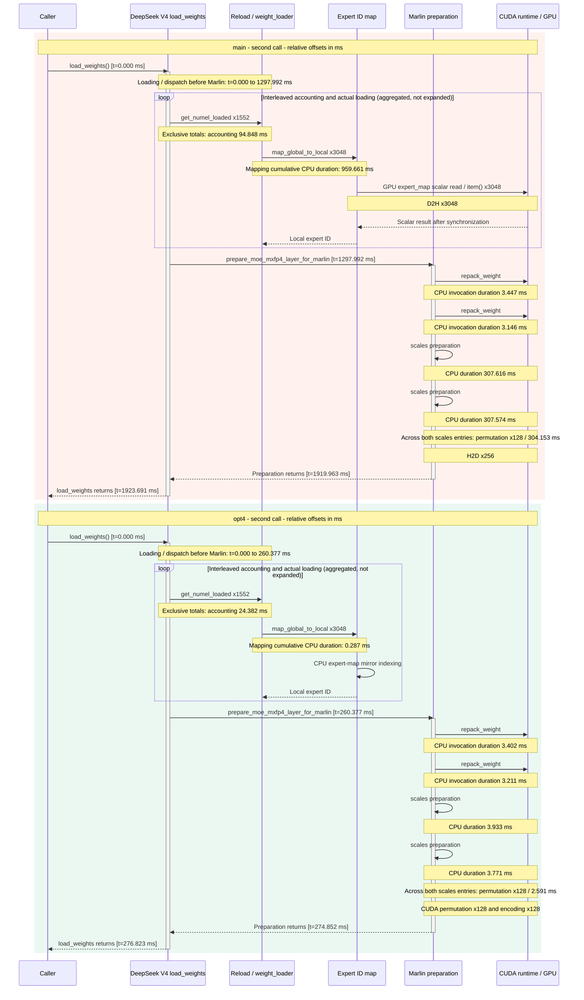

# 第二次 load_weights 调用：优化前后分析

## 1. 窗口与结论

只比较两份 trace 按时间排序的 **第二次 `vllm/models/deepseek_v4/nvidia/model.py(1439): load_weights`**，不比较其他调用，不使用四次累计或均值。main **1923.691 ms** → opt4 **276.823 ms**，减少 **1646.868 ms / 85.61%**，加速 **6.95×**。

窗口排除外层 broadcast、bucket 重建、最终同步/finalize、GC/empty_cache；包含函数内权重计数、实际 loader、Marlin 后处理及 CPU 等待。耗时是 profiled inclusive CPU duration，不单独证明 GPU 工作在退出时全部完成。

## 2. 步骤时间占比、调用次数、加速比

### 非重叠分解（占比合计 100%）

| 步骤                                    | main 时间 (ms) | main 占比 | main 次数 | opt4 时间 (ms) | opt4 占比 | opt4 次数 |   加速比 |
| --------------------------------------- | -------------: | --------: | --------: | -------------: | --------: | --------: | -------: |
| Expert ID 映射                          |        959.661 |    49.89% |      3048 |          0.287 |     0.10% |      3048 | 3346.33× |
| 加载元素计数（扣除映射）                |         94.848 |     4.93% |      1552 |         24.382 |     8.81% |      1552 |    3.89× |
| 实际 weight_loader（扣除映射/计数路径） |         18.955 |     0.99% |      1524 |         17.966 |     6.49% |      1524 |    1.06× |
| Scales permutation                      |        304.153 |    15.81% |       128 |          2.591 |     0.94% |       128 |  117.41× |
| MXFP4 scales encoding                   |        308.717 |    16.05% |       128 |          3.183 |     1.15% |       128 |   97.00× |
| Scales 入口其他工作（扣除两个子步骤）   |          2.320 |     0.12% |         2 |          1.931 |     0.70% |         2 |    1.20× |
| Weight repack                           |          6.593 |     0.34% |         2 |          6.613 |     2.39% |         2 |    1.00× |
| 其余工作 / 间隙（次数为残余段数）       |        228.444 |    11.88% |      3081 |        219.871 |    79.43% |      3081 |    1.04× |
| load_weights 总计                       |       1923.691 |   100.00% |         1 |        276.823 |   100.00% |         1 |    6.95× |

基于真实事件起止做区间扫描，嵌套优先级：mapping → accounting → 实际 loader → permutation → encoding → scales 其余 → repack → 其余窗口。mapping 全部计入映射行；计数扣除映射；实际 loader 扣除映射并排除计数内调用；scales 其余扣除两个子步骤。这是选定步骤的 exclusive 区间分解，不是 profiler self CPU；步骤内更细子调用、分配和等待仍保留。

次数为入口次数，不是扫描段数；**"其余工作/间隙"的次数是连续残余区间数，不是函数调用次数**。Scales 其他工作的次数为其父入口数，代表两次入口的剩余工作。占比以各自窗口为分母，优化后比例升高不等于绝对时间增加。加速比按本行非重叠耗时计算。

### 原始函数 inclusive 数据（父子重叠，不可相加）

| 步骤                                      | main 时间 (ms) | main 占比 | main 次数 | opt4 时间 (ms) | opt4 占比 | opt4 次数 |   加速比 |
| ----------------------------------------- | -------------: | --------: | --------: | -------------: | --------: | --------: | -------: |
| map_global_to_local                       |        959.661 |    49.89% |      3048 |          0.287 |     0.10% |      3048 | 3346.33× |
| get_numel_loaded                          |        175.842 |     9.14% |      1552 |         24.557 |     8.87% |      1552 |    7.16× |
| RoutedExperts.weight_loader（合计数路径） |       1027.190 |    53.40% |      3048 |         18.078 |     6.53% |      1524 |   56.82× |
| 计数范围内 RoutedExperts.weight_loader    |        129.568 |     6.74% |      1524 |          0.000 |     0.00% |         0 |        — |
| MoE scales 入口                           |        615.190 |    31.98% |         2 |          7.704 |     2.78% |         2 |   79.85× |
| permutation 子函数                        |        304.153 |    15.81% |       128 |          2.591 |     0.94% |       128 |  117.41× |
| encoding 子函数                           |        308.717 |    16.05% |       128 |          3.183 |     1.15% |       128 |   97.00× |
| CopyCounter.**torch_dispatch**            |         50.056 |     2.60% |      4936 |          0.651 |     0.24% |        96 |   76.88× |

此表占比是函数 inclusive duration / 窗口，不构成 100% 分解。get_numel_loaded、weight_loader 与映射有父子重叠。

优化前 mapping 占 49.89%，scales 父入口占 31.98%，两类合计约 81.87%。优化后分别只占 0.10% 和 2.78%，剩余其他工作成为主要部分（79.43%），但其绝对时间实际从 228.444 ms 略降到 219.871 ms。实际 loader 非映射工作仅加速约 1.06×，因此本次主要收益是同步与重复计数路径的消除，而不是 weight copy 本体显著加速。

## 3. 三个优化点的证据

| 事件                        | main 次数 | main 时间 (ms) | opt4 次数 | opt4 时间 (ms) | 加速比 |
| --------------------------- | --------: | -------------: | --------: | -------------: | -----: |
| 映射内 D2H (GPU)            |      3048 |          7.177 |         0 |          0.000 |      — |
| 映射内 stream 同步 (CPU)    |      3048 |        870.633 |         0 |          0.000 |      — |
| scales 内 H2D (GPU)         |       256 |          0.215 |         0 |          0.000 |      — |
| scales 内 stream 同步 (CPU) |       256 |        594.433 |         0 |          0.000 |      — |
| scales GPU kernels          |       516 |          1.983 |       260 |          1.230 |  1.61× |
| scales cudaMalloc (CPU)     |         0 |          0.000 |         0 |          0.000 |      — |

- CPU expert map：映射次数仍为 3,048，D2H 和对应 stream 同步均 3,048 → 0。收益主要是消除细粒度 GPU 标量等待，不是几字节传输带宽。
- 计数快路径：weight_loader 总调用 3,048 → 1,524，计数内 1,524 → 0，实际路径仍 1,524；get_numel_loaded 两边均 1,552。快路径仍查 expert，因此映射总次数未减半。独占分解避免将映射收益重复记入计数。
- CUDA scales：父入口 2 次，permutation/encoding 各 128 次；H2D 和同步各 256 → 0，GPU kernels 516 → 260（含转换/cat）。CPU 入口加速不能当作 GPU kernel 加速，也不能描述为所有 experts 一次融合。

## 4. load_weights 真实时序图

顶部总耗时使用**相同横轴尺度**；下面 main/opt4 细节使用**各自局部横轴**，展现真实起止和嵌套关系。第一轨是非重叠归因，其余轨是 inclusive 函数。短调用保持真实宽度，不人为放大；SVG 事件带悬停名称、偏移、duration。opt4 映射几乎不可见，数值以表格为准。图不是抽象流程图，也不是 GPU 完成时间线；GPU 按窗口内 launch correlation 归因，可在 CPU 窗口结束后完成。

Marlin 较大事件起止（相对本窗口起点）：

| trace | 事件                               | 起点偏移 (ms) | 终点偏移 (ms) | duration (ms) |
| ----- | ---------------------------------- | ------------: | ------------: | ------------: |
| main  | prepare_moe_mxfp4_layer_for_marlin |      1297.992 |      1919.963 |       621.971 |
| main  | repack_weight                      |      1298.015 |      1301.462 |         3.447 |
| main  | repack_weight                      |      1301.492 |      1304.639 |         3.146 |
| main  | permute_scales                     |      1304.668 |      1612.284 |       307.616 |
| main  | permute_scales                     |      1612.320 |      1919.894 |       307.574 |
| opt4  | prepare_moe_mxfp4_layer_for_marlin |       260.377 |       274.852 |        14.475 |
| opt4  | repack_weight                      |       260.402 |       263.804 |         3.402 |
| opt4  | repack_weight                      |       263.837 |       267.048 |         3.211 |
| opt4  | permute_scales                     |       267.079 |       271.013 |         3.933 |
| opt4  | permute_scales                     |       271.046 |       274.817 |         3.771 |

### Mermaid 时序图（可直接复制 Markdown）

下图使用实际起止偏移标注主要调用；Mermaid 的纵向间距**不按耗时比例缩放**。计数和实际加载交错执行，loop 仅汇总调用关系，不表示所有计数先完成、所有加载后开始；loop 的 duration 标注为整个窗口的累计 CPU 时间。GPU 工作异步提交，CPU 返回不等于 GPU 完成。可直接复制本代码块，或使用独立文件 `load_weights_call2_sequence.md` / `load_weights_call2_sequence.mmd`。

## 5. 数据、验证与 PR 注意事项

- 两份 trace 均为 H200、rank 0/world_size 4、CUDA runtime 13.0、NCCL 2.28.9、with_stack=1。工作量计数匹配不证明每个 tensor 输入一致或权重正确；全更新 opt4 广播字节数多约 0.0400%，精确 commit/TP/EP/PP 待补充。
- 仅第二次调用的一对观测，不是重复实验、消融、生产延迟或整个 RL 吞吐结果。减少 dispatch 也减少 profiler 记录开销，需同输入关闭 profiler 重复测量。
- Chrome Trace 微秒除以 1,000；CPU 事件同 pid/tid 且完整包含，GPU 按 runtime correlation。main start ts=5435811552109.443 µs；opt4=5809337800950.445 µs。
- `comparison.csv` 仅 call_index=2，区分 exclusive/inclusive/event；`call2_analysis.json` 保存非重叠段/次数/时间；SVG 保存真实时序。底层 main/opt4 summary 保留全部调用仅用于审计。
- 按顺序运行 `node --max-old-space-size=24576 analyze_traces.cjs &gt; exploration.txt`、`node render_report.cjs`、`node validate_analysis.cjs`。验证覆盖流式解析、线程/包含、GPU correlation、窗口聚合、独占区间完整覆盖且时间相加等于总窗口。
- vLLM 正确性测试/编译/lint 未运行。已有 utils.ops 测试不自动覆盖新 utils.marlin_scales；需人工审阅并测试实际 CUDA parity、计数/并行分支/finalize。
- 重复 PR 检查未完成（无 gh、GitHub 不可达、无 issue）；提交前补齐 issue/comments 与 open PR 检查和测试结果，披露 AI assistance，禁止重复 PR。
